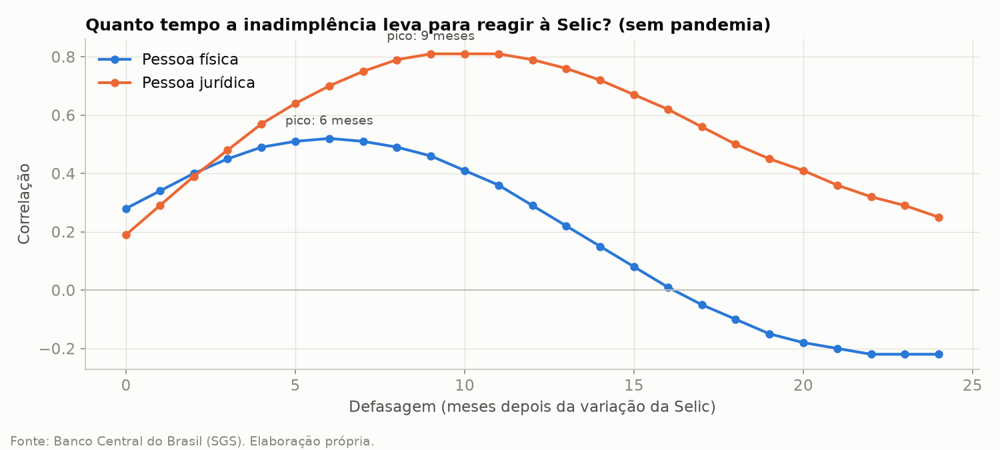
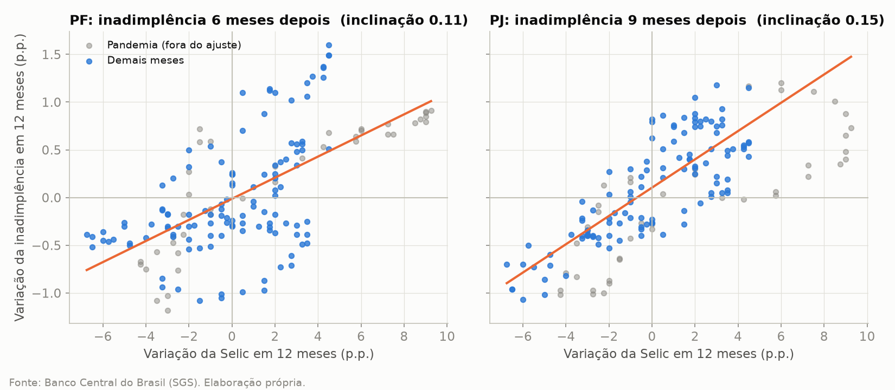
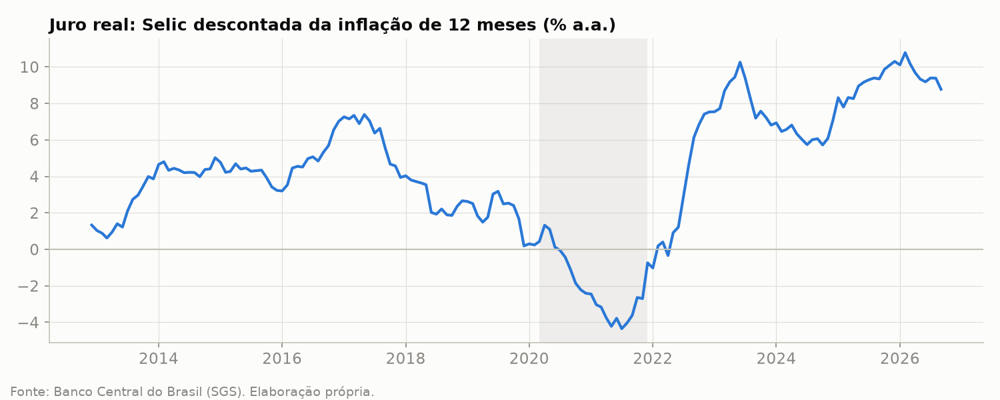

# Selic e inadimplência no Brasil (2012-2026)

**Pergunta:** quando os juros sobem, quanto tempo leva para a inadimplência subir? E a Selic explica a
alta recente da inadimplência das famílias?

Análise com 14 anos de dados públicos do Banco Central sobre como a Selic se transmite à inadimplência
de pessoas físicas (PF) e jurídicas (PJ). O tema é relevante para a política de crédito e para o
cálculo da provisão para perdas (IFRS 9 / Resolução CMN 4.966).


## Resumo

| Pergunta | Resposta |
|---|---|
| A inadimplência reage à Selic? | Sim, com defasagem de cerca de 6 meses (PF) e 9 meses (PJ) |
| Quem é mais sensível? | Pessoa jurídica: reage mais tarde, mas com mais intensidade e consistência |
| Qual o tamanho do efeito? | Alta de 4 p.p. na Selic: +0,44 p.p. de inadimplência PF e +0,59 p.p. PJ |
| A Selic explica a alta recente das famílias? | Não. A inadimplência PF subiu 2,24 p.p. desde nov/2024, bem acima do previsto |

**Implicação para o negócio:** na carteira PJ, o efeito de uma alta de juros é previsível e chega em
cerca de 9 meses, o que dá tempo para ajustar a política de crédito e a provisão. Na carteira PF, a
Selic explica só 27% da variação da inadimplência. Monitorar apenas os juros subestima o risco das
famílias.

## Resultados

### 1. A inadimplência reage com defasagem
A correlação entre a variação da Selic e a variação da inadimplência é máxima 6 meses depois para PF
e 9 meses depois para PJ.



### 2. Hipótese rejeitada: a PF não é mais sensível que a PJ

| | Defasagem | Inclinação | Correlação | R² |
|---|---|---|---|---|
| Pessoa física | 6 meses | 0,111 | 0,52 | 0,27 |
| Pessoa jurídica | 9 meses | 0,148 | 0,81 | 0,66 |

A PF reage antes, mas a PJ reage com mais força e consistência. Uma explicação possível: boa parte do
crédito PJ é pós-fixado, mas as empresas têm caixa, garantias e capacidade de renegociar, por isso
demoram mais para atrasar. Já a inadimplência das famílias depende também de emprego, renda e
endividamento.



### 3. A alta recente da inadimplência PF não é explicada pela Selic

| Ciclo de alta 2024-2025 | Previsto pela relação histórica | Observado (nov/2024 a set/2026) |
|---|---|---|
| Pessoa jurídica | cerca de +0,7 p.p. | +0,78 p.p. |
| Pessoa física | cerca de +0,5 p.p. | +2,24 p.p. |

As empresas seguiram o padrão histórico. As famílias, não. Algo além dos juros pressiona a
inadimplência PF desde 2025. Pontos a investigar: endividamento, comprometimento de renda e possíveis
efeitos da mudança contábil de 2025.

### 4. Contexto: juro real em nível historicamente alto
O juro real atingiu 10,78% em fev/2026, o maior da série. Em set/2026 estava em 8,77%, mais que o
dobro da média do período (cerca de 4%).



## Metodologia

**Fonte:** API pública do SGS (Banco Central do Brasil).

| Série | Código SGS |
|---|---|
| Selic meta (% a.a.) | 432 |
| IPCA, variação mensal (%) | 433 |
| Inadimplência total, PJ e PF (%) | 21082, 21083 e 21084 |
| Spread médio das operações de crédito (p.p.) | 20783 |

**Fluxo dos dados:**
```
API do BCB → src/coleta.py → data/bruto/ → src/tratamento.py → data/tratado/ → notebooks
```

**Tratamento:**
- A Selic é diária. Foi usado o valor vigente no último dia de cada mês.
- IPCA de 12 meses calculado por juros compostos. Juro real ex-post pela equação de Fisher.
- A análise usa variações em 12 meses, e não níveis. Isso evita correlação espúria entre séries com
  tendência e remove a sazonalidade.
- O período de mar/2020 a dez/2022 foi excluído da análise principal. Na pandemia, carências e
  renegociações reduziram a inadimplência ao mesmo tempo em que a Selic caía, o que inflava a
  correlação PF (0,64 com a pandemia, 0,52 sem).

**Verificações de qualidade:**
- Quebra de série com a Resolução CMN 4.966 (jan/2025): não há salto abrupto. A alta é gradual e
  coerente com o ciclo da Selic.
- Sazonalidade: a inadimplência PF cai em média em junho e dezembro (fechamentos semestrais, baixas a
  prejuízo, 13º salário) e sobe em janeiro.

**Técnicas:** correlação defasada (0 a 24 meses) e regressão linear simples, com e sem o período da
pandemia.

## Limitações
- As variações em 12 meses se sobrepõem, e a amostra tem na prática 3 a 4 ciclos da Selic. Os
  resultados indicam direção e defasagem, não prova estatística.
- A análise considera só a Selic. Não controla emprego, renda, endividamento nem programas de
  renegociação, como o Desenrola.
- Correlação não implica causalidade.
- Os dados de crédito são divulgados com cerca de 2 meses de atraso.

## Próximos passos
- Incluir endividamento e comprometimento de renda das famílias.
- Testar um modelo com mais variáveis (Selic, desemprego, renda) e o juro real ex-ante.
- Usar as relações estimadas como cenário macroeconômico no cálculo de perda esperada.

## Estrutura do projeto
```
painel-credito-bcb/
├── data/
│   ├── bruto/              # dados como vieram da API
│   └── tratado/            # base mensal com indicadores
├── figuras/                # gráficos do README e das publicações
├── notebooks/
│   ├── 01_exploracao.ipynb # análise exploratória e qualidade dos dados
│   └── 02_defasagem.ipynb  # defasagem, sensibilidade e hipóteses
├── src/
│   ├── coleta.py           # coleta das séries na API do BCB
│   └── tratamento.py       # limpeza e cálculo dos indicadores
└── requirements.txt
```

## Como reproduzir
```bash
git clone https://github.com/nediao03/painel-credito-bcb.git
cd painel-credito-bcb
python -m venv .venv
source .venv/Scripts/activate      # Windows (Git Bash). Linux/Mac: source .venv/bin/activate
python -m pip install -r requirements.txt
python src/coleta.py               # baixa os dados do Banco Central
python src/tratamento.py           # gera data/tratado/base_mensal.csv
```
Depois, abra os notebooks da pasta `notebooks/`.

**Ferramentas:** Python, pandas, NumPy, Matplotlib, Requests, Jupyter e Git.

## Autor
**Guilherme Fernandes da Costa** | Analista e Cientista de Dados
[LinkedIn](https://www.linkedin.com/in/guilhermefernandesdacosta/)


## Atualização dos dados
Os dados e gráficos são atualizados automaticamente todo mês via GitHub Actions
(`.github/workflows/atualizacao.yml`). Os números citados no texto referem-se à análise com dados
até set/2026.