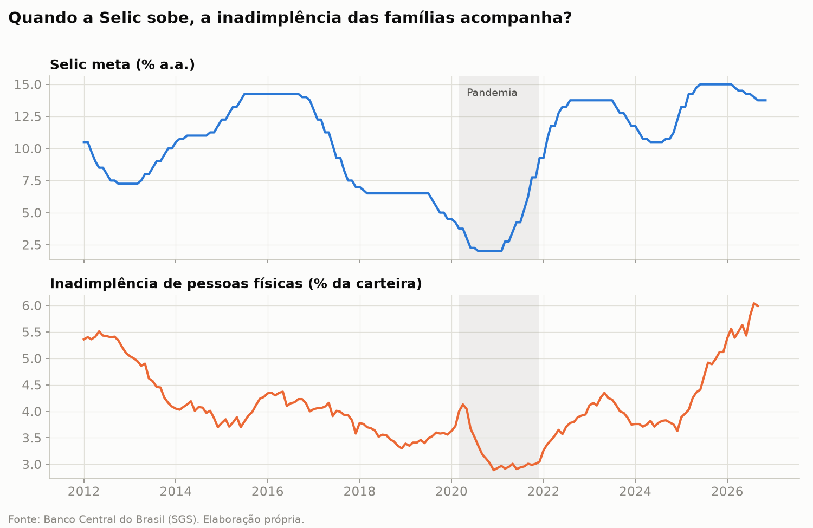

# Selic × Inadimplência no Brasil (2012–2026)

**Pergunta:** quando a Selic sobe, a inadimplência sobe também? Com quanto tempo de defasagem?

## Principais resultados
- A inadimplência reage à Selic com defasagem de **~6 meses (pessoa física)** e **~9 meses (pessoa jurídica)**.
- A PJ é **mais sensível** e mais consistente; a PF apenas reage antes.
- A alta recente da inadimplência PF (+2,24 p.p. desde nov/2024) é **~4× o que a Selic explicaria** — há outros fatores pressionando as famílias.

## Como foi feito
Dados públicos do Banco Central (API SGS) → coleta automatizada em Python → base tratada em camadas
(bruto/tratado) → análise exploratória → correlação defasada e sensibilidade, com e sem o período da pandemia.

- Análise exploratória: [`notebooks/01_exploracao.ipynb`](notebooks/01_exploracao.ipynb)
- Defasagem e hipóteses: [`notebooks/02_defasagem.ipynb`](notebooks/02_defasagem.ipynb)

*README completo e dashboard interativo em construção.*
